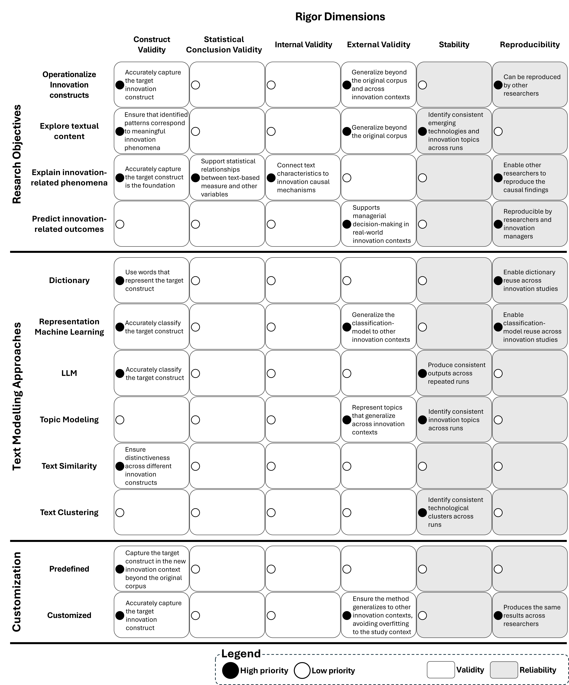

# Rigorous Text Analysis in Innovation Research: Evidence and Guidelines

This repository provides the code, datasets, and article classifications accompanying the paper **“Rigorous Text Analysis in Innovation Research: Evidence and Guidelines.”** The materials support the study’s conceptual and empirical analyses and are shared to facilitate transparency, reproducibility, and further research.

The study examines 174 articles published over 20 years in leading innovation and management journals. It assesses how these studies address validity and reliability, identifies rigor priorities across research contexts, and offers 23 rigor strategies illustrated by exemplary studies.

## Dimensions of validity and reliability

What makes a text-analysis study rigorous? Our approach distinguishes four dimensions of validity—**statistical conclusion, internal, external, and construct validity**—and two dimensions of reliability—**stability and reproducibility**.

The first figure presents the definitions of these dimensions, providing a common reference for assessing rigor throughout a text-analysis study.

*Figure 1. Definitions of the dimensions of validity and reliability.*

## A framework for addressing rigor across research contexts

The dimensions of rigor that require particular attention depend on the research context. Our framework guides the identification of these priorities by considering three elements together:

| Element | Guiding question |
| --- | --- |
| **Research objective** | Is text analysis used to operationalize a construct, explore patterns, explain relationships, or predict outcomes? |
| **Text-modelling approach** | Which approach is used to analyze the text, and what assumptions and analytical choices does it involve? |
| **Customization** | Is the approach used without modification, or is it developed or adapted for the study? |

The second figure brings these elements together to show how rigor priorities vary across research contexts.

*Figure 2. Rigor priorities according to research objectives, text-modelling approaches, and whether the approach is customized.*

These priorities guide methodological choices; they do not remove the need to consider other dimensions of rigor or explain the trade-offs made in a particular study.

## Code, datasets, and article classifications

The repository provides:

- **Code** supporting the study’s empirical analyses.
- **Datasets** underlying the examination of rigor practices across the reviewed studies.
- **Article classifications** documenting the coding used in the review.

Together, these resources allow readers to inspect the evidence underlying the paper, reproduce its analyses, and build on its findings.
